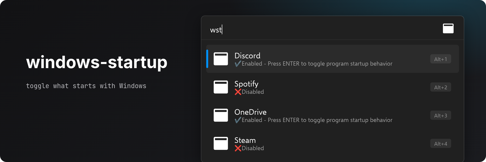

<!-- generated by readwright from docs/README.md.j2; edit the template, not this file -->


# Windows Startup

See and toggle the programs that start with Windows, from Flow Launcher.

[](https://github.com/Garulf/Windows-Startup/actions/workflows/tests.yml) [](https://github.com/Garulf/Windows-Startup/releases/latest) [](https://github.com/Garulf/Windows-Startup/releases/latest)

[](https://www.buymeacoffee.com/garulf) [](https://github.com/sponsors/Garulf)

## Features

* **Everything that starts with Windows.** Lists the `Run` and `Run32` registry entries and the Startup folder items, for your account and for all users.
* **See what is on.** Each entry shows whether it is enabled or disabled.
* **Toggle with Enter.** Turns an entry on or off the same way Task Manager's Startup tab does.
* **Find the program.** Open it, or reveal it in File Explorer, from the context menu.

## Usage

Type `wst` to list your startup programs, or add part of a name to filter them. Press `Enter` to toggle the selected program:

```
wst spotify
```


### Context menu

Open the context menu (`Shift+Enter` or right-click) to open the program, reveal it in File Explorer, or enable or disable it explicitly:


Changing entries for all users (`HKEY_LOCAL_MACHINE`) needs Flow Launcher to run as administrator.

## Installation

### Flow Launcher

In Flow Launcher, type:

```
pm install windows startup
```


### Manual installation

Download `Windows-Startup-<version>.zip` from the [latest release](https://github.com/Garulf/Windows-Startup/releases/latest) and unzip it into
`%appdata%\FlowLauncher\Plugins`, then restart Flow Launcher.

Pre-releases of the next version are published from the open release PR on the
[releases page](https://github.com/Garulf/Windows-Startup/releases) for testing. Flow Launcher won't offer them as updates.

## Requirements

* Windows 10 or 11
* Flow Launcher 1.17.0 or newer
* Python 3.8 or newer, which Flow Launcher can install for you

## Changelog

### [1.0.2](https://github.com/Garulf/Windows-Startup/releases/tag/v1.0.2) - 2022-01-12

- Update the Flox requirement

### [1.0.1](https://github.com/Garulf/Windows-Startup/releases/tag/v1.0.1) - 2021-11-17

- More descriptive subtitle

### [1.0.0](https://github.com/Garulf/Windows-Startup/releases/tag/v1.0.0) - 2021-11-16

- Open `.lnk` startup items with their default handler
- Find Startup folder items more reliably

See [CHANGELOG.md](CHANGELOG.md) for the full history.
